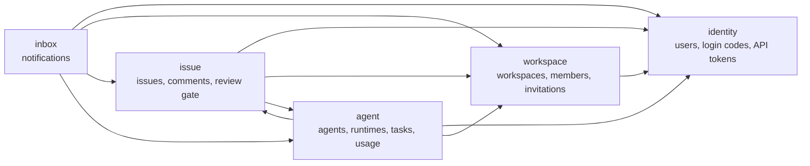
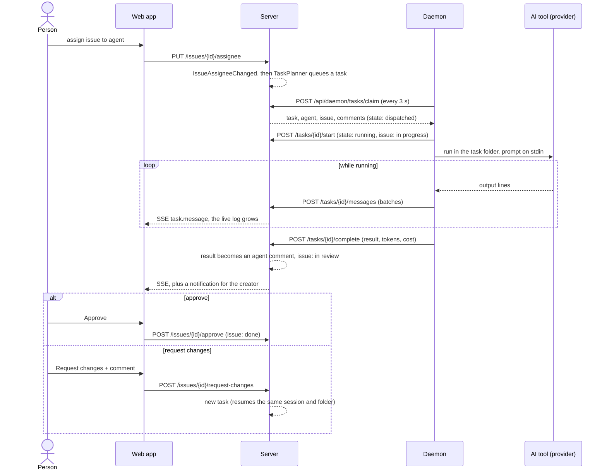

# Orchestragent

People and AI agents working on the same issues. Assign an issue to an agent like you would to a
teammate: a local daemon picks up the task, runs Claude Code CLI on your machine, streams progress in
real time, and moves the issue to review for a human to approve.

> Status: all twelve steps of `PLAN.md` are implemented, including the end-to-end test, the login rate limit, the
> development seed data and the report notes ([docs/architecture-report.md](docs/architecture-report.md)).

## Requirements

- JDK 21 (Gradle can also download one automatically through the foojay toolchain resolver, but a JVM
  17+ is still needed to start Gradle itself)
- Docker (Docker Desktop on Windows/macOS)
- Node.js 22+ and pnpm 10 (for `frontend/`). If `pnpm` is not installed, Corepack (bundled with Node) can
  run the pinned version without a global install: `corepack pnpm@10.18.0 -C frontend dev`.

## Getting started

```bash
cp .env.example .env        # then fill in JWT_SECRET (openssl rand -base64 32)
docker compose up -d        # Postgres on 5432, Mailpit SMTP on 1025, Mailpit UI on http://localhost:8025
./gradlew build
```

On Windows PowerShell use `Copy-Item .env.example .env` and `.\gradlew.bat build`.

Run the backend (needs Postgres running and `JWT_SECRET` set in `.env`; the app refuses to start with a
secret shorter than 32 bytes):

```bash
./gradlew :backend:app:bootRun --args='--spring.profiles.active=dev'
curl http://localhost:8080/api/health
```

The integration tests start their own Postgres with Testcontainers, so Docker must be running.

### Logging in (step 2)

Login is passwordless: `POST /api/auth/code {email}` emails a 6-digit code (open Mailpit at
http://localhost:8025 in development), `POST /api/auth/verify {email, code}` checks it and sets the
HttpOnly `oa_session` cookie. Codes expire after 10 minutes, allow 5 wrong guesses, can be requested once
per minute per address, and are stored only as a keyed hash.

Browser requests are protected by CSRF tokens: read the `XSRF-TOKEN` cookie and send its value in the
`X-XSRF-TOKEN` header on every write. Requests that use an `Authorization: Bearer` header do not need it.
The daemon API (`/api/daemon/**`) accepts only API tokens (`oat_...`) created via `POST /api/me/tokens`.

With the `dev` profile and `DEV_LOGIN_CODE` set, that fixed code logs in any email address. Other profiles
ignore `DEV_LOGIN_CODE` completely.

### Workspaces and members (step 4)

A user can belong to several workspaces. The creator is the owner; roles are `owner`, `admin` and `member`:
owners manage anyone, admins manage members only, members manage nobody (except leaving), and a workspace always
keeps at least one owner. Admins and owners invite people by email; the email contains a link
(`APP_BASE_URL/invitations/{id}`), and the invitation can only be accepted by someone signed in with the
invited address. Anyone who is not a member of a workspace gets `404` from its endpoints, so its existence is not
revealed. The full rules are in `PLAN.md` (step 4).

REST: `GET|POST /api/workspaces`, `GET /api/workspaces/{id}`, `GET /api/workspaces/{id}/members`,
`PATCH|DELETE /api/workspaces/{id}/members/{userId}`, `GET|POST /api/workspaces/{id}/invitations`,
`DELETE /api/workspaces/{id}/invitations/{invitationId}`, `GET /api/invitations`,
`POST /api/invitations/{id}/accept`. Each context owns its Postgres schema (`workspace` here) and no foreign key
crosses schemas; a test enforces this.

### Issues, board and comments (step 5)

Every workspace member can create, edit, assign, move and comment on issues; only the creator, admins and owners
delete one. Issue numbers (`ORC-12`; the prefix comes from the workspace slug) count up per workspace. Status is one of
`backlog, todo, in_progress, in_review, done, blocked, cancelled` (any status may follow any other); priority is one of
`none, low, medium, high, urgent`. Issues can only be assigned to members until agents arrive in step 7.

REST under `/api/workspaces/{id}/issues`: `GET` (filters `status`, `priority`, `assignee`, `unassigned`, `limit`; returns
`{items, total}`, newest first, at most 1000), `POST`, `GET /{issueId}`, `GET /number/{n}`, `PATCH /{issueId}`,
`PUT /{issueId}/assignee`, `POST /{issueId}/move` (`{status, aboveId, belowId}`: the server computes the position between
the two neighbours and renumbers a column when they get too close; a stale drop answers `409 issue.stale_move`),
`DELETE /{issueId}`, and `GET|POST /{issueId}/comments`. Other contexts hear about changes through the integration
events `IssueCreated`, `IssueUpdated`, `IssueAssigneeChanged`, `IssueDeleted` and `CommentAdded` (module `issue-contract`).

The web app has a six-column board (drag with mouse, touch or keyboard), a list view, filters that are remembered per
workspace, a create dialog and an issue page with inline editing, a properties panel and a comment timeline.

### Live updates (step 6)

`GET /api/workspaces/{id}/events` is a Server-Sent Events stream, open to members only (anyone else gets `404`, like
every workspace endpoint). The issue context's listener turns its integration events into `issue.created`,
`issue.updated`, `issue.deleted` and `comment.created` (each carries only `issueId` and what changed), plus a
`heartbeat` event every 25 seconds. The events carry no data on purpose: the web app marks the affected queries stale
and fetches them again, so a repeated or reordered event cannot show something older than the server has. Delivery
runs through `@ApplicationModuleListener` (after the commit, on its own thread); handled events are deleted from
`event_publication` (`spring.modulith.events.completion-mode: delete`).

The browser side (`shared/api/eventStream.ts`) reconnects with a growing delay when the browser gives up, treats 60
seconds without any event or heartbeat as a dead connection, and fetches the whole workspace again after a break.

### Agents and runtimes (step 7)

A **runtime** is one AI tool (provider, for example `claude`) on one computer (daemon) that registered with a
workspace; it is online while its daemon sends heartbeats, and a job that runs every 30 seconds marks runtimes
silent for over 90 seconds offline. An **agent** is an AI teammate: a name, markdown instructions, an optional
model, and the runtime that does its work. Agents are archived, never deleted: an archived agent cannot be given
work or edited (restore it first), but issues it already has keep its name.

Rules: every member sees agents and runtimes. An agent runs work on the computer of whoever owns its runtime, so
a person can only point an agent at a runtime of their own; the creator, admins and owners edit, archive and
restore it (`AgentPolicy`, mirrored by `permissions.ts`). Active agents of a workspace have distinct names
(ignoring case, also enforced by a partial unique index).

REST under `/api/workspaces/{id}`: `GET /runtimes`, and `GET|POST /agents` (`?includeArchived=true`),
`GET|PUT /agents/{agentId}`, `POST /agents/{agentId}/archive`, `POST /agents/{agentId}/restore`. Registering,
heartbeats and deregistering are use cases of `RuntimeService`; the daemon API that calls them (with API tokens)
arrives in step 8, so for now runtimes can only be created through the service (tests do this).

Issues can be assigned to agents: the issue context asks the agent context through its contract
(`agent-contract`: `AgentDirectory`), and the assignee picker of the web app lists members and agents (agents with
the purple spark). The web app has Agents and Runtimes pages; the Runtimes page also explains how to connect a
computer.

### Agent tasks, the daemon API and the review gate (step 8)

A **task** is one run of an agent on an issue. Tasks are made from what happens on issues (the rules are in
`TaskPlanner`, one test per row of the table in `PLAN.md`): assigning an issue to an agent queues a task unless the
issue is done or cancelled; a person's comment queues one unless one is already waiting; sending work back from
review queues one (trigger `changes_requested`); comments of agents and of the system never do, so agents cannot set
each other off in a loop; unassigning, reassigning or deleting cancels the agent's tasks, and so does archiving the
agent. An issue never has two waiting tasks (a partial unique index), and every event makes at most one task (the task
remembers its source event), because events are delivered at least once.

A task goes `queued` → `dispatched` (a daemon claimed it and has 60 seconds to start it) → `running` →
`completed`, `failed` or `cancelled`. A job (every 30 seconds) puts unstarted claims back in the queue, and fails
running tasks of runtimes that went offline (`runtime_offline`). Claiming is one SQL statement with
`FOR UPDATE SKIP LOCKED`: two daemons polling at once never get the same task, and one issue never runs twice at once.
The calls a daemon repeats when its network drops (start, complete, fail, messages) are safe to repeat, and reports
for a task that was cancelled are accepted and ignored; the daemon learns about the cancellation from `status`.

**Daemon API** (`/api/daemon/**`, API tokens only, wire format in `daemon-protocol`): `GET /workspaces`,
`POST /register`, `/heartbeat`, `/deregister`, `POST /tasks/claim`, `POST /tasks/{id}/start`, `/messages`,
`/complete`, `/fail`, `GET /tasks/{id}/status`. Every call acts for the owner of the token and only reaches what they
own; someone else's runtime or task is "not found". A person who left the workspace gets no more work. A claim hands
over the agent (name, instructions, model), the issue, its comments and, when the agent worked on the issue before,
the session and folder to resume.

**Review gate**: when a task completes, the agent's result becomes a comment of the agent and the issue moves to
"in review"; when it fails, a system comment says why and the issue moves to "blocked"; when it starts, the issue moves
to "in progress". An agent can never mark an issue done: a member calls `POST /issues/{id}/approve` (done) or
`POST /issues/{id}/request-changes {comment}` (back to "to do", the comment is required and starts a new run). Both need
the issue to be in review.

Web API under `/api/workspaces/{id}/tasks`: `GET ?issueId=`, `GET /{taskId}/messages?after=`, `POST /{taskId}/cancel`,
`POST /{taskId}/retry`. The issue page has an "Agent runs" panel (state, duration, tokens, cost, the live log, Cancel
and Retry) and, for an issue in review, the review bar. The live updates of step 6 carry `task.updated` and
`task.message`.

### The daemon (step 9)

The daemon is a plain Java command-line program (`daemon/daemon-cli`, picocli) that runs agents on your computer.
Build and install it, create an API token in the web app (Settings > API tokens), then log in and start it:

```bash
./gradlew :daemon:daemon-cli:installDist
daemon/daemon-cli/build/install/orchestragent-daemon/bin/orchestragent-daemon login --server http://localhost:8080 --token
daemon/daemon-cli/build/install/orchestragent-daemon/bin/orchestragent-daemon doctor
daemon/daemon-cli/build/install/orchestragent-daemon/bin/orchestragent-daemon start --providers mock
```

On Windows run `orchestragent-daemon.bat` from the same folder. In development give the backend's address
(`http://localhost:8080`), not the Vite dev server's: Vite listens on IPv6 only (`[::1]:5173`), and Java connects to
`localhost` over IPv4.

- `login --server URL --token oat_...` checks the token with the server (`--no-verify` skips that) and saves
  `~/.orchestragent/config.json` (server, token and a daemon ID made once), readable only by you (`rw-------`, or an
  access list with only your account on Windows). `--token` without a value asks for it, so it stays out of the shell
  history. Settings in the file that the daemon does not know are kept.
- `doctor` lists the providers and whether each tool is installed, shows the login (never the token) and checks that
  the server accepts it.
- `start [--providers claude,mock] [--max-tasks 2] [--task-timeout 30] [--device-name NAME]` runs in the foreground.
  Without `--providers` it uses every installed tool except the mock. It registers the providers in every workspace
  of the token's owner (one runtime per provider), sends a heartbeat every 15 seconds and claims tasks every
  3 seconds while it has free slots. Each task runs on its own thread: the daemon prepares its folder, writes the
  prompt (agent instructions, the issue, its comments, what the run is for, and how to report), starts the task, runs
  the provider, sends the log in batches every second and checks every 5 seconds whether the task was cancelled.
  The result is reported with retries and backoff; all log lines are sent before it. Ctrl+C stops claiming, waits up to
  30 seconds for running tasks, stops the rest (reported as failed, `daemon_stopped`) and takes the runtimes offline.
- Task folders live under `~/.orchestragent/workspaces/<workspaceId>/<issueNumber>-<last 8 characters of the task ID>/`. A run that
  continues earlier work gets the earlier folder back, and resumes the earlier session only there (AI tools keep
  sessions per folder). A folder sent by the server is used only when it is inside the task's workspace folder.
- `ORCHESTRAGENT_HOME` moves `~/.orchestragent` elsewhere (tests and demos).

Providers implement `AgentProvider` (`daemon/daemon-provider-api`): `id()`, `detect()`, `run(request, listener,
cancel)`, and are found with `java.util.ServiceLoader`, so a new tool is a new module with a
`META-INF/services/com.orchestragent.daemon.provider.AgentProvider` file. The **mock provider** never calls a model:
it pauses between steps (`ORCHESTRAGENT_MOCK_STEP_MS`, default 1000), sends four or five log lines, writes
`mock-notes.md` in the task folder and answers with a text that names the issue. Put `[mock:fail]`, `[mock:hang]` or
`[mock:crash]` in the issue title, description or a comment to make it fail, hang until cancelled or timed out, or
throw; the last marker wins, so a later comment with `[mock:ok]` makes it succeed again.

### The Claude Code provider (step 10)

The `claude` provider (`daemon/daemon-provider-claude`) runs the Claude Code CLI that is installed and signed in on
the computer. `doctor` shows whether it was found (`claude --version`, looked up on `PATH`; on Windows `claude.exe`, or
`claude.cmd` from npm, which is started through `cmd.exe`). A run is

```
claude -p --output-format stream-json --verbose --permission-mode <mode> [--model M] [--resume SESSION]
       [--allowedTools ...] --disallowedTools AskUserQuestion [...]
```

in the task folder, with the prompt on standard input (so no issue text is ever a command-line argument). Each line of
output is JSON: the session ID comes from the `init` message, assistant text and tool calls and tool results become the
live log, and the `result` message gives the final answer (the agent's comment), the tokens (input counts prompt-cache
reads and writes) and the cost. Tool calls show their main argument (`Bash npm test`, `Write notes/BYE.md`; paths in
the task folder are relative). A run stops when it takes longer than `--task-timeout` (30 minutes by default) or prints
nothing for 10 minutes, and when the task is cancelled; stopping kills the whole process tree. When a run ends, any
process it started that is still running (a dev server left in the background, say) is killed too. A later run on the same
issue resumes the session in the same folder; when Claude Code says the session no longer exists, the run starts once
more without it. Variables that Claude Code sets for its own child processes (`CLAUDECODE`, ...) are not passed on, so
the daemon can be started from a Claude Code terminal.

What Claude may do is set in the `"claude"` section of `~/.orchestragent/config.json` (`login` keeps it):

```json
"claude": {
  "permissionMode": "acceptEdits",
  "allowedTools": ["Bash(npm test:*)", "Bash(git diff:*)"],
  "disallowedTools": [],
  "idleTimeoutMinutes": 10,
  "command": "claude"
}
```

The default `acceptEdits` lets the agent read and edit files in its task folder; commands run only when `allowedTools`
allows them. `bypassPermissions` lets it do anything the account can do; the daemon uses it only when you set it, and
prints a warning. A wrong setting stops `start` and `doctor` with a message. `AskUserQuestion` is always disallowed,
because nobody can answer a question during a run.

Tests never run the real CLI: the parser reads JSONL fixtures (one of them recorded from Claude Code 2.1.311) and the
process handling runs a fake CLI (a small Java program). One smoke test runs the real one and costs money:
`ORCHESTRAGENT_RUN_REAL_CLAUDE=1 ./gradlew :daemon:daemon-provider-claude:test --tests '*RealClaudeSmokeTest'`.

### Usage and inbox (step 11)

**Usage** (`GET /api/workspaces/{id}/usage?days=30`, 1 to 365 days, any member; the **Usage** page offers 7, 30 and
90): the runs of agents that ended in the period (today and the days before it, in UTC), with how many completed and
failed, input and output tokens, and cost, in total, per agent, per day (every day of the period, zeros on quiet days)
and for the 20 most expensive issues. Postgres sums them over `agent.agent_tasks`; a run that reported no tokens or
cost counts as zero, and input tokens include prompt-cache reads and writes, as the daemon reports them. The page draws
one measure per day at a time (cost, runs or tokens; never two scales on one chart) and has the same numbers as a table.
It refreshes when a run changes.

**Inbox** (a new context, schema `inbox`): a notification tells one person something about an issue.

| What happened | Who is told |
| --- | --- |
| Someone assigned an issue to a person | that person, unless they assigned themselves |
| An agent finished an issue (it waits for review) | the person who created the issue |
| An agent failed on an issue | the person who created the issue, with the reason |
| The issue was deleted | its notifications go away |

People who are no longer members are not told. A notification keeps a copy of the issue number and title and of who
did it. Events are delivered at least once, so a notification remembers its event: one event makes at most one
notification per person (a unique key in the database). `GET /api/workspaces/{id}/inbox` returns the newest 100 and the
unread count, `GET .../inbox/unread-count` only the count (the badge next to **Inbox** in the navigation),
`POST .../inbox/{id}/read` and `POST .../inbox/read-all` mark them read. Nobody sees or reads another person's
notifications (404). The live update `inbox.updated` goes only to the browsers of the person whose inbox changed: the
event stream now knows who opened each connection.

### Hardening, seed data and end-to-end tests (step 12)

**Login rate limit.** `POST /api/auth/code` allows at most 10 requests per client address in any 10 minutes (on top of
the rule of one code per email address per minute); the next one answers `429` with a `Retry-After` header and the
code `login.ip_rate_limited`, and no email is sent. The count is kept in memory (`SlidingWindowRateLimiter` in
`platform`), so each server instance counts for itself, and rejected requests are not counted. Change it with
`orchestragent.rate-limit.auth-code.max-requests` and `orchestragent.rate-limit.auth-code.window` (for example
`--orchestragent.rate-limit.auth-code.window=30m`). The address is the one the servlet container reports: **behind a
reverse proxy set `server.forward-headers-strategy=native`** (and make sure the proxy overwrites
`X-Forwarded-For`), otherwise every user looks like the proxy and shares one limit.

**Loading, empty and error states.** Every page shows a skeleton while it loads, a message with a "Try again"
button when the request fails, and a sentence that says what to do when there is nothing yet. A page that crashes
while rendering shows a "Something went wrong" page (`RouteErrorPage`) instead of a blank screen; its details go only
to the browser console.

**Seed data.** With the `dev` profile, an empty database gets a demo user and a workspace on the first start
(`DevDataSeeder`): sign in as `demo@example.com` with the fixed `DEV_LOGIN_CODE`. The workspace "Demo" has eight
issues in every status and a few comments. It runs once (nothing happens when the demo user exists) and never stops
the application if it fails; turn it off with `--orchestragent.dev-seed.enabled=false`. No agent is seeded, because
an agent needs a runtime and a runtime exists only after a daemon on a computer registers: create the first agent in
the web app after `orchestragent-daemon start` (see the demo script below).

**End-to-end test** (`e2e/`, Playwright). One story, in a real browser, against the real thing: sign in with the dev
code, create a workspace, connect a daemon (mock provider), create an agent, create an issue assigned to it, wait for
"In review", request changes, wait for "In review" again, approve, see "Done", and find the notification in the inbox.
No AI model is called.

```bash
docker compose up -d                                  # Postgres and Mailpit must run
pnpm -C frontend install && pnpm -C e2e install       # once
pnpm -C e2e test                                      # builds the jar and the daemon, starts everything, runs, stops
```

- It uses your installed Google Chrome, so nothing is downloaded (`E2E_BROWSER=msedge` for Edge, or
  `E2E_BROWSER=chromium` after `pnpm -C e2e exec playwright install chromium`).
- It starts its own backend on port 18080 and Vite on 15173 and recreates an empty database `orchestragent_e2e` in the
  Postgres container of `docker compose` (`E2E_POSTGRES_CONTAINER` if you named it differently), so a backend or
  frontend you have open, and your development data, are not touched. The daemon uses a throwaway
  `ORCHESTRAGENT_HOME`. The login code and the JWT secret of the run are made up for the run.
- `E2E_SKIP_BUILD=1` skips the Gradle call (use it when nothing changed). JDK 21 must be found through `JAVA_HOME`
  or `PATH`.
- A daemon registers only in the workspaces that exist when it starts, so the test starts the daemon after it created
  the workspace instead of in the global setup.
- Logs of the backend, Vite and daemon are in `e2e/test-results/logs/`; a failed run keeps a screenshot and a trace
  (`pnpm -C e2e exec playwright show-trace <trace.zip>`).

### Frontend (step 3)

```bash
pnpm -C frontend install
pnpm -C frontend dev        # http://localhost:5173, proxies /api to the backend on :8080
pnpm -C frontend typecheck && pnpm -C frontend lint && pnpm -C frontend test && pnpm -C frontend build
```

Start the backend and `docker compose up -d` first. Open http://localhost:5173, enter an email, read the
code in Mailpit (http://localhost:8025) and type it in.

The look follows Jira (Atlassian Design System): the palette, typography and shapes are defined once as CSS
variables ("tokens") in `frontend/src/index.css` and described in `PLAN.md` ("Giao diện (UI)"). Components use
token classes only; a test fails if a component contains a raw colour or a default Tailwind palette class.

Layout of `frontend/src`: `app/` (router, providers), `features/<feature>/` (`api.ts`, `schemas.ts`,
`components/`, `pages/`), `shared/api/` (fetch client with CSRF header and zod parsing), `shared/ui/`
(shadcn/ui components). Every API response is parsed with a zod schema; type assertions (`as T`) and `any`
are lint errors outside the generated `shared/ui` files.

## Architecture

Orchestragent is a **modular monolith**: one Spring Boot application, split into bounded contexts that talk only
through small public modules (`*-contract`). The rules are enforced by Gradle dependencies, by ArchUnit tests and by a
test that checks no SQL crosses a schema. Why this shape, and how to split it into services later, is in
[docs/architecture-report.md](docs/architecture-report.md).

**Context map.** An arrow means "uses the contract of". `platform` (security, errors, events, SSE) is shared
infrastructure.



`issue` and `agent` use each other, but for different things: `issue` asks `agent` whether an agent may be assigned
(`AgentDirectory`, synchronous) and `agent` asks `issue` for the issue behind a task (`IssueDirectory`); everything
else travels as integration events, delivered after the commit with the Spring Modulith event publication registry
(transactional outbox) and handled by idempotent listeners.

**Life of a task.**



## Adding a provider

A provider is how the daemon runs one AI tool. Adding one means adding a module; the daemon itself does not change.

1. Create `daemon/daemon-provider-<name>` with `plugins { id("oa.java-library") }` and a dependency on
   `:daemon:daemon-provider-api`. Add it to `settings.gradle.kts` and as `runtimeOnly(project(...))` in
   `daemon/daemon-cli/build.gradle.kts`. Versions of libraries go in `gradle/libs.versions.toml`.
2. Implement `AgentProvider` (package `com.orchestragent.daemon.provider`):
   - `id()`: the short code stored on the runtime (`[a-z0-9][a-z0-9._-]{0,49}`).
   - `detect()`: look for the tool (return empty when it is not installed; never throw).
   - `run(request, listener, cancel)`: do the work, send progress with `listener.onMessage(type, text)`, return a
     `RunResult` (completed with the output, tokens and cost, or failed with a reason). A tool that fails is a
     failed result, not an exception. Return soon after `cancel` fires and kill everything you started. One provider
     object serves several tasks at once, so keep per-run state out of fields.
   - Optional: `configure(settings)` reads your section of `~/.orchestragent/config.json`, and `enabledByDefault()` says
     whether `start` uses it when no `--providers` are given.
3. List the class in `src/main/resources/META-INF/services/com.orchestragent.daemon.provider.AgentProvider`.
4. Test it without the real tool: the mock provider and the fake `claude` of `daemon-provider-claude` are examples
   (a small program started as a real process). Tests never run a real AI tool; a test that does must be switched on
   by an environment variable (`ORCHESTRAGENT_RUN_REAL_CLAUDE=1` is the model).
5. `orchestragent-daemon doctor` lists the new provider, and `start --providers <name>` runs it.

## Demo script

About ten minutes, with the mock provider (no AI model, no cost). Start with `docker compose up -d`.

1. Backend: `JWT_SECRET=<32+ random bytes> DEV_LOGIN_CODE=123456 ./gradlew :backend:app:bootRun --args='--spring.profiles.active=dev'`.
   The log says that seed data was created.
2. Frontend: `pnpm -C frontend dev`, open http://localhost:5173, sign in as `demo@example.com` with the code `123456`.
3. Look around the seeded "Demo" workspace: the board (drag a card), the list and its filters, an issue with its
   comments, Members.
4. Settings > API tokens: create a token and copy it.
5. Daemon: `./gradlew :daemon:daemon-cli:installDist`, then in `daemon/daemon-cli/build/install/orchestragent-daemon/bin`
   run `orchestragent-daemon login --server http://localhost:8080 --token` (paste the token), then
   `orchestragent-daemon start --providers mock`.
6. Runtimes: the computer appears as online. Agents > Create agent ("Mock Writer", pick the runtime).
7. Open "Write the API documentation" (or create an issue) and assign it to the agent. Watch the status go to "In
   progress", the live log fill, the agent's comment appear and the status go to "In review".
8. Request changes with a comment: a second run starts in the same folder and resumes the same session. When it is in
   review again, press Approve: the issue is done.
9. Inbox shows what happened (with a badge while unread), Usage shows runs, tokens and cost per day and per agent.
10. Put `[mock:fail]` in a comment to see a failed run: the issue goes to "Blocked" with a system comment.

For a run with the real Claude Code, start the daemon with `--providers claude` instead (it costs money; give it a
small issue first).

## Environment variables

| Variable         | Purpose                                                             |
| ---------------- | ------------------------------------------------------------------- |
| `DB_URL`         | JDBC URL of the Postgres database                                   |
| `DB_USER`        | Database user (also used by Docker Compose to create the user)      |
| `DB_PASSWORD`    | Database password                                                   |
| `JWT_SECRET`     | HS256 signing secret, at least 32 bytes                             |
| `MAIL_HOST`      | SMTP host (Mailpit in development)                                  |
| `MAIL_PORT`      | SMTP port                                                           |
| `APP_BASE_URL`   | Public URL of the web app, used in emails                           |
| `DEV_LOGIN_CODE` | Fixed login code, accepted only with the `dev` profile              |

Other settings are Spring properties (`--name=value`, or the matching environment variable):

| Property                                          | Default | Purpose                                                |
| ------------------------------------------------- | ------- | ------------------------------------------------------ |
| `orchestragent.rate-limit.auth-code.max-requests` | `10`    | Login codes one client address may ask for per window  |
| `orchestragent.rate-limit.auth-code.window`       | `10m`   | Length of that window                                  |
| `orchestragent.dev-seed.enabled`                  | `true`  | `dev` profile only: create the demo user and workspace |

The end-to-end tests read `E2E_BROWSER`, `E2E_SKIP_BUILD` and `E2E_POSTGRES_CONTAINER` (see above).

## Project layout

```
build-logic/   Gradle convention plugins (oa.java-library, oa.spring-library, oa.spring-app, oa.java-app)
backend/       Spring Boot modular monolith: shared-kernel, platform, identity, workspace, issue, agent, inbox, app
daemon/        Java daemon that runs agents locally (protocol, provider SPI, mock and Claude providers, CLI)
frontend/      React + Vite + TypeScript + shadcn/ui
e2e/           Playwright end-to-end test (real browser, backend, database and daemon with the mock provider)
```

Architecture and coding rules: see [AGENTS.md](AGENTS.md). Full plan: see [PLAN.md](PLAN.md).

## Technology decisions

- Spring Boot 4.0.9 and Spring Modulith 2.0.9 (latest 4.0.x / 2.0.x patches at bootstrap time).
- Gradle 9.8.2 with a single version catalog in `gradle/libs.versions.toml`.
